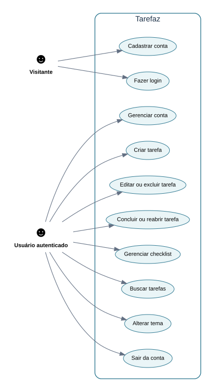

# Diagrama de Casos de Uso

O diagrama apresenta as principais interações com o sistema.

## Atores

- **Visitante:** pessoa que ainda não possui uma sessão autenticada.
- **Usuário autenticado:** pessoa que realizou login e pode acessar os recursos pessoais do Tarefaz.

## Casos de uso

| Ator | Casos de uso |
|---|---|
| Visitante | Cadastrar conta e fazer login. |
| Usuário autenticado | Gerenciar conta, criar tarefa, editar ou excluir tarefa, concluir ou reabrir tarefa, gerenciar checklist, buscar tarefas, alterar tema e sair da conta. |

Cada funcionalidade de tarefa é vinculada ao usuário autenticado. Dessa forma, as tarefas e itens de checklist de uma conta não podem ser acessados por outra conta.
