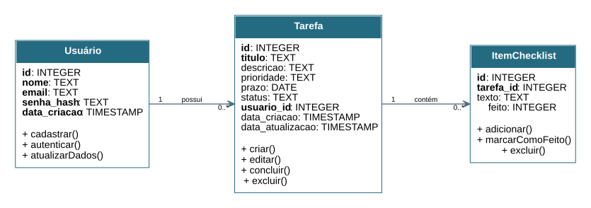

# Diagrama de Classes

O diagrama representa as três entidades principais do sistema e seus relacionamentos.

## Classes e responsabilidades

| Classe | Responsabilidade |
|---|---|
| Usuário | Armazena os dados de acesso e identifica o proprietário das tarefas. |
| Tarefa | Representa uma atividade pessoal, com título, descrição, prioridade, prazo e situação. |
| ItemChecklist | Representa um item complementar vinculado a uma tarefa. |

## Relacionamentos

- Um **Usuário** pode possuir zero ou muitas **Tarefas**.
- Cada **Tarefa** pertence a um único **Usuário**.
- Uma **Tarefa** pode conter zero ou muitos **Itens de Checklist**.
- Cada **Item de Checklist** pertence a uma única **Tarefa**.

Os atributos apresentados foram definidos a partir da estrutura real do banco de dados SQLite do Tarefaz.
