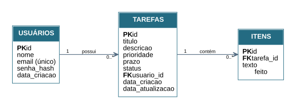

# Modelo Conceitual e Lógico do Banco de Dados

## Modelo conceitual

O banco de dados do Tarefaz foi definido a partir de três entidades principais:

- **Usuário:** representa a pessoa que possui uma conta no sistema.
- **Tarefa:** representa uma atividade cadastrada pelo usuário.
- **Item:** representa uma etapa ou anotação de checklist ligada a uma tarefa.

Os relacionamentos são:

- Um usuário pode possuir nenhuma, uma ou várias tarefas.
- Uma tarefa pertence a apenas um usuário.
- Uma tarefa pode conter nenhum, um ou vários itens de checklist.
- Um item de checklist pertence a apenas uma tarefa.

## Modelo lógico

| Tabela | Chave primária | Chaves estrangeiras | Finalidade |
|---|---|---|---|
| usuarios | id | - | Armazena contas e dados de autenticação. |
| tarefas | id | usuario_id → usuarios.id | Armazena tarefas e seus prazos, prioridade e situação. |
| itens | id | tarefa_id → tarefas.id | Armazena itens de checklist de cada tarefa. |

## Regras de integridade

- O e-mail do usuário é único.
- O título de uma tarefa não pode ficar vazio.
- A prioridade aceita os valores `media` ou `alta`.
- A situação de uma tarefa aceita os valores `a_fazer` ou `concluido`.
- O campo `feito` de um item aceita 0 para pendente e 1 para concluído.
- A exclusão de um usuário remove suas tarefas; a exclusão de uma tarefa remove seus itens de checklist, por meio de exclusão em cascata.

O modelo físico, com tipos completos dos campos, está implementado em [app/schema.sql](../app/schema.sql) e detalhado no [dicionário de dados](dicionario-de-dados.md).
